# Spring Boot Todo REST API

Spring Boot를 이용하여 Todo REST API를 구현한 프로젝트입니다.

## 1. 개발 환경

- Java 26
- Spring Boot 4.1.1
- Gradle
- IntelliJ IDEA
- Spring Web MVC

## 2. 구현 기능

총 8개의 REST API를 구현했습니다.

| Method | URL | 기능 | 정상 응답 |
|---|---|---|---|
| POST | `/api/todos` | Todo 생성 | 201 Created |
| POST | `/api/todos/{id}/complete` | Todo 완료 처리 | 200 OK |
| GET | `/api/todos` | 전체 Todo 조회 | 200 OK |
| GET | `/api/todos/{id}` | 특정 Todo 조회 | 200 OK |
| PUT | `/api/todos/{id}` | Todo 내용 수정 | 200 OK |
| PUT | `/api/todos/{id}/priority?priority={value}` | 우선순위 수정 | 200 OK |
| DELETE | `/api/todos/{id}` | 특정 Todo 삭제 | 200 OK |
| DELETE | `/api/todos` | 전체 Todo 삭제 | 200 OK |

## 3. Middleware

`LoggingFilter`를 구현하여 서버에 들어오는 HTTP 요청의 Method와 URI를 출력하도록 구현했습니다.

예시:

```text
[REQUEST] GET /api/todos
[REQUEST] POST /api/todos
[REQUEST] PUT /api/todos/1
[REQUEST] DELETE /api/todos/1
```

## 4. HTTP Status Code

과제 요구사항에 따라 2xx, 4xx, 5xx에서 각각 두 종류 이상의 상태 코드를 사용했습니다.

| 분류 | Status Code | 사용 상황 |
|---|---|---|
| 2xx | 200 OK | 조회, 수정, 삭제 성공 |
| 2xx | 201 Created | Todo 생성 성공 |
| 4xx | 400 Bad Request | 잘못된 요청 값 |
| 4xx | 404 Not Found | Todo를 찾을 수 없음 |
| 5xx | 500 Internal Server Error | 서버 내부 오류 |
| 5xx | 503 Service Unavailable | 서버 점검 상황 |

## 5. 공통 응답 형식

모든 API 응답은 `status`와 `data`를 사용하는 공통 형식으로 구성했습니다.

성공 응답 예시:

```json
{
  "status": "success",
  "data": {
    "id": 1,
    "title": "Spring Boot 과제하기",
    "completed": false,
    "priority": 1
  }
}
```

오류 응답 예시:

```json
{
  "status": "error",
  "data": "Todo를 찾을 수 없습니다."
}
```

## 6. 예외 처리

`GlobalExceptionHandler`를 사용하여 서버에서 발생하는 예외를 공통 응답 형식으로 처리했습니다.

- 일반적인 서버 오류: `500 Internal Server Error`
- 서비스 이용 불가: `503 Service Unavailable`

## 7. 실행 및 테스트 결과

### POST - Todo 생성 (201 Created)

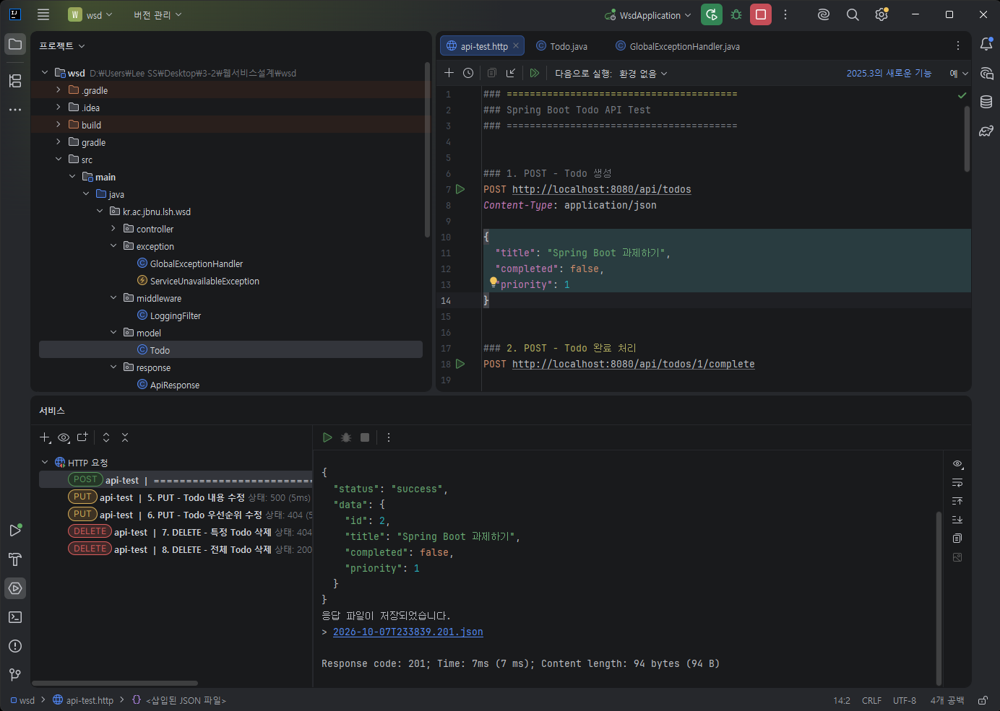

### POST - Todo 완료 처리 (200 OK)

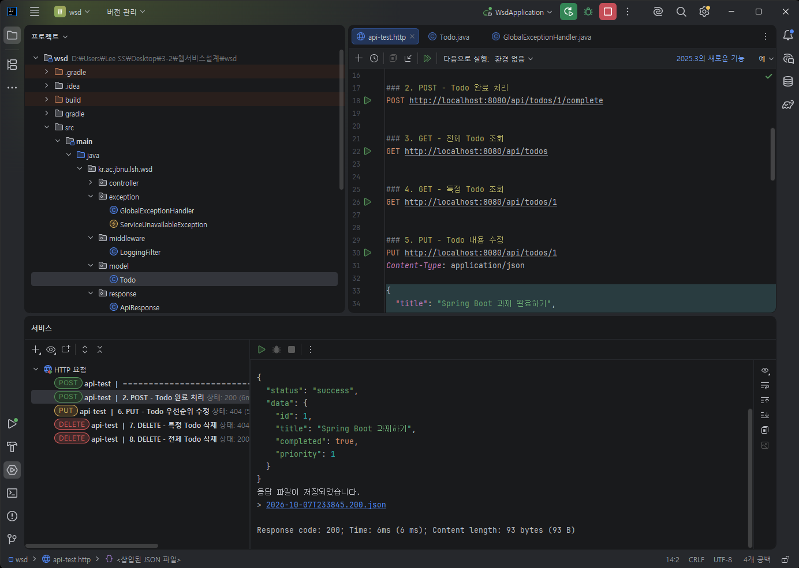

### GET - 전체 Todo 조회 (200 OK)

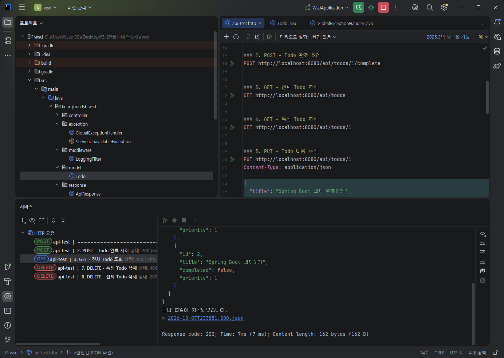

### GET - 특정 Todo 조회 (200 OK)

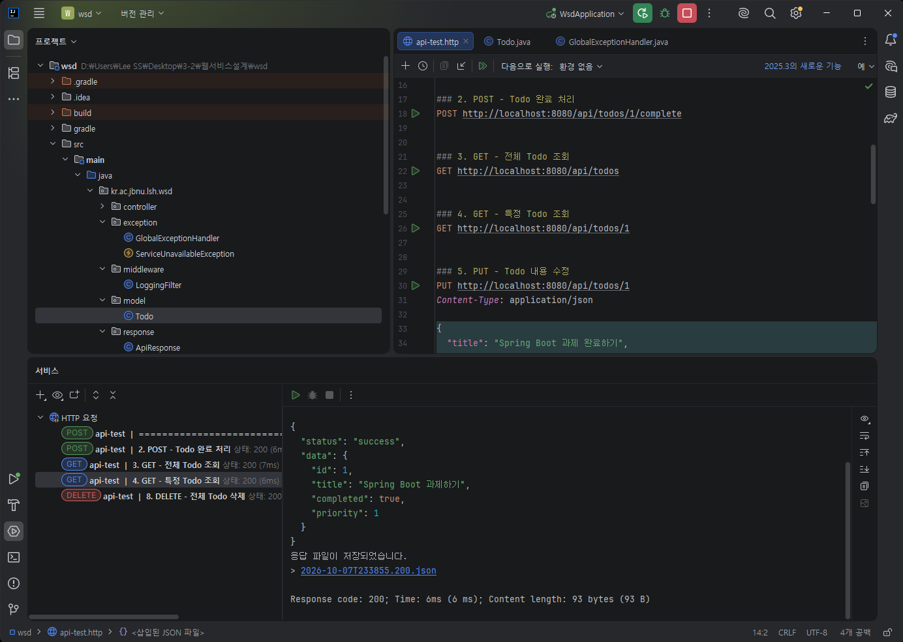

### PUT - Todo 내용 수정 (200 OK)

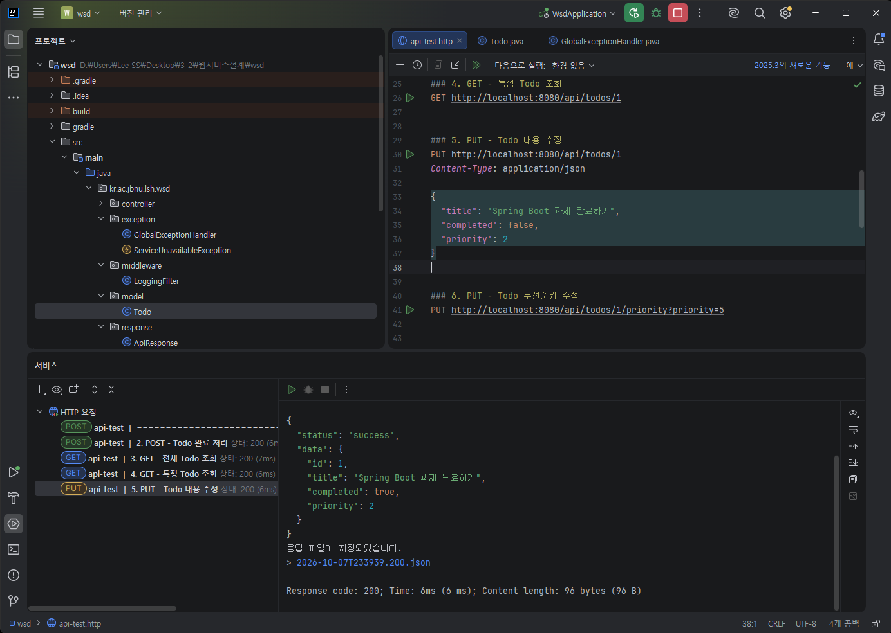

### PUT - Todo 우선순위 수정 (200 OK)

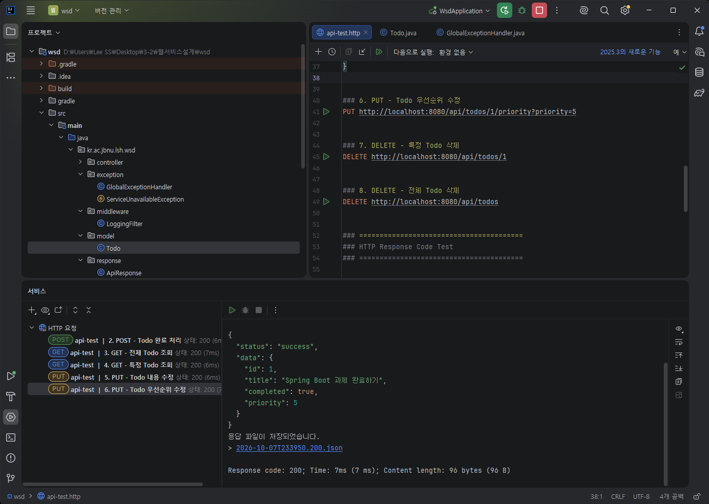

### DELETE - 특정 Todo 삭제 (200 OK)

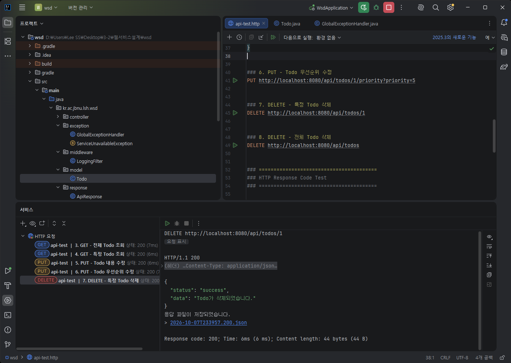

### DELETE - 전체 Todo 삭제 (200 OK)

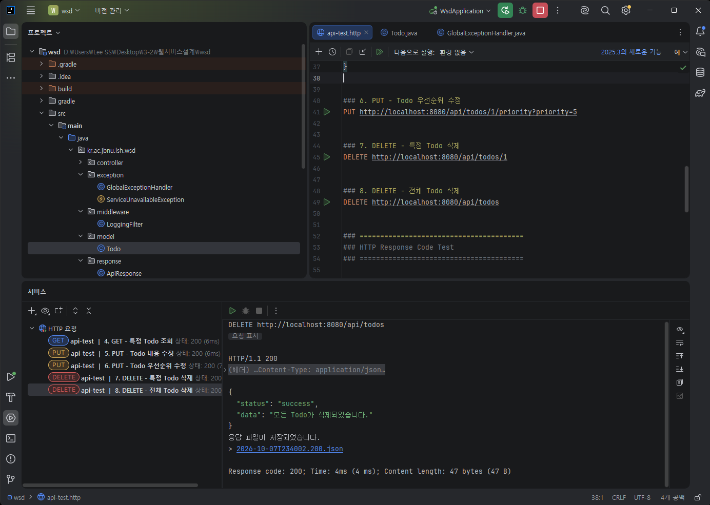

## 8. HTTP Status Code 테스트

### 400 Bad Request

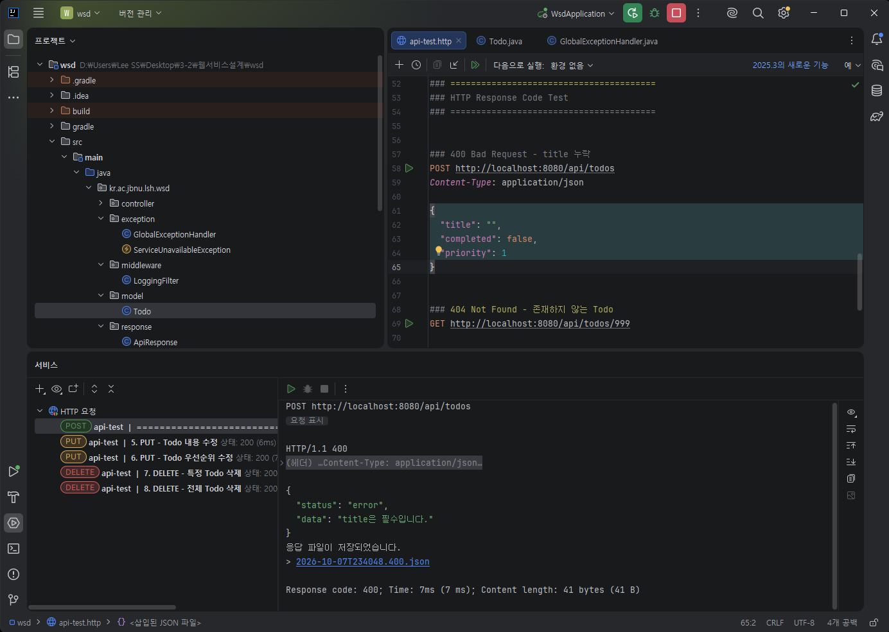

### 404 Not Found

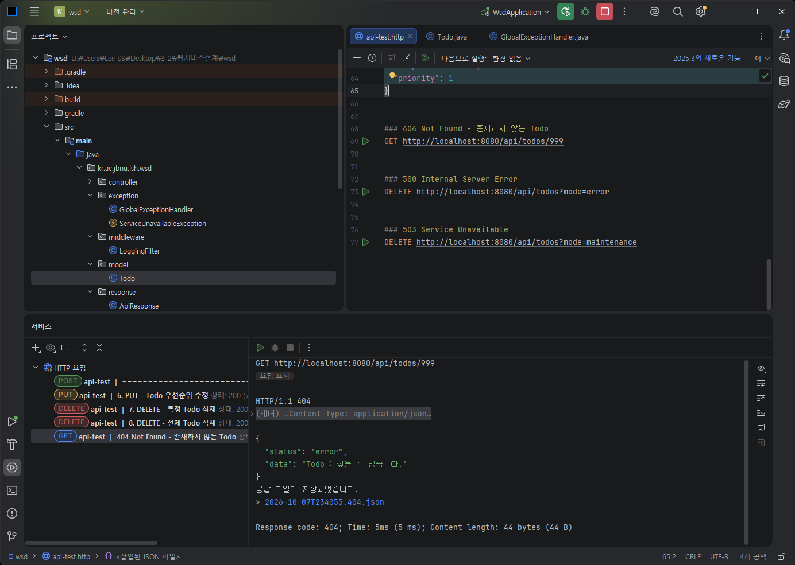

### 500 Internal Server Error

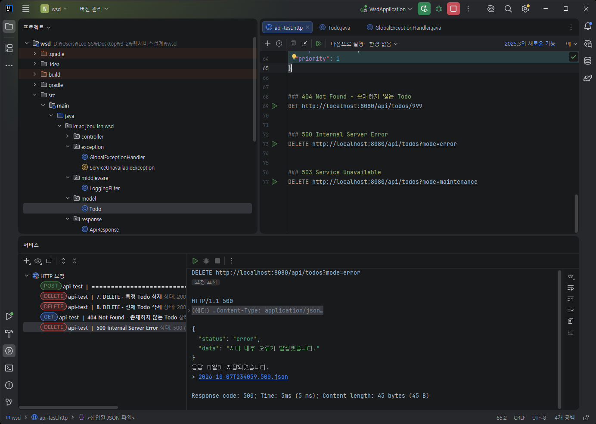

### 503 Service Unavailable

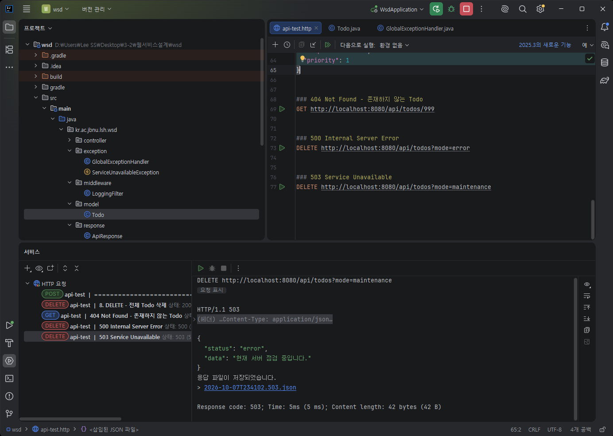

## 9. Middleware 실행 결과

LoggingFilter를 통해 요청 Method와 URI가 출력되는 것을 확인했습니다.

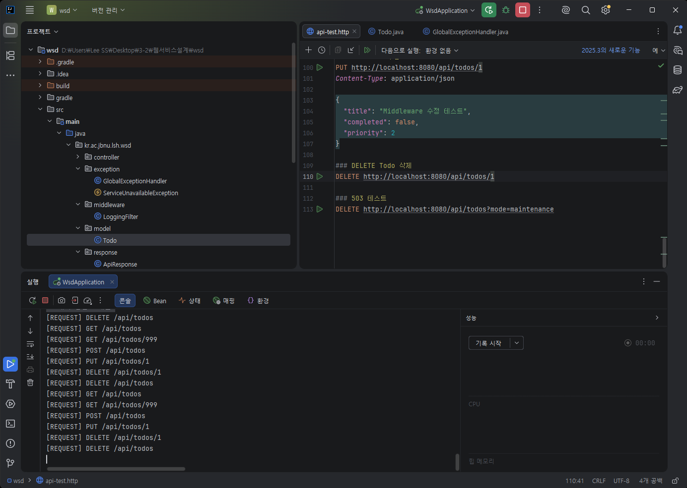
## 8. 프로젝트 구조

```text
src/main/java/kr/ac/jbnu/lsh/wsd
├── controller
│   └── TodoController.java
├── exception
│   ├── GlobalExceptionHandler.java
│   └── ServiceUnavailableException.java
├── middleware
│   └── LoggingFilter.java
├── model
│   └── Todo.java
├── response
│   └── ApiResponse.java
├── service
│   └── TodoService.java
└── WsdApplication.java
```